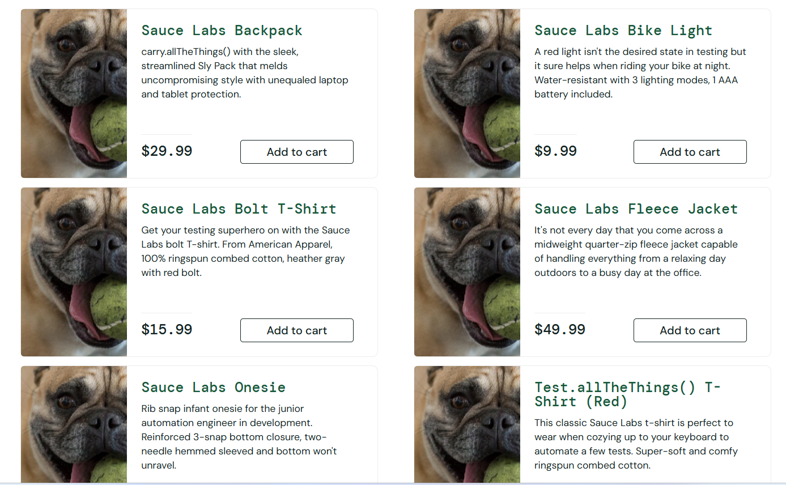

## BUG-002- Fleece jacket pas repertorier.

### 1- Information : 
- Projet : SauceDemo
- ID : BUG-002
- Type : Anomalie visuelle
- Compte : problem_user
- Statut : Identifie 
- Severite : Importante

 ### 2- Descriptiom du probleme :
  Sur la page "Products" lorsque l'on clqieu sur le produit "Fleece Jacket", un message d'erreur apparait et il est impossible non seulement de voir le produit et sa description mais aussi de le mettre dans le panier.

 ### 3- Precondition :
  - Acceder a la page de connexion.
  - Utiliser le compte "problem_user".
  - Aller sur la page "Products".
  - Cliquer sur le produit "Fleece Jacket".
 
 ### 4- Etapes pour reproduire l'erreur : 
 - Ouvrir SauceDemo.
 - Se connecter avec le compte "problem_user".
 - Acceder a la page "Products".
 -  Cliquer sur le produit "Fleece Jacket".

### 5- Resultat attendu : 
Un message d'erreur apparait quand on clique sur le produit "Fleece Jacket". 

### 6- Resultat obtenu : 
Un message d'erreur "Item not Found" apparait quand on clique sur le produit "Fleece Jacket". 

### 7- Impact utilisateur : 
Un client potentiel interesse par le produit ne pourra pas se le procurer.

### 8 - Conclusion : 
Une anomalie d'affichage a ete detectee depuis le compte "problem_user".

### 9 - Preuve visuelle : 

  
