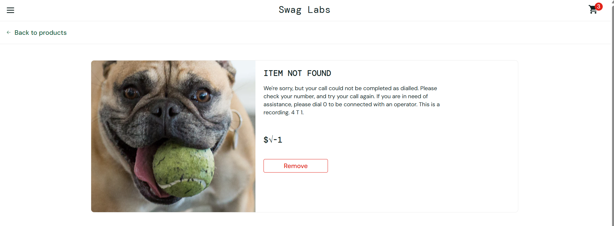

## BUG-003- Page "About" indisponible.

### 1- Information : 
- Projet : SauceDemo
- ID : BUG-003
- Type : Anomalie visuelle
- Compte : problem_user
- Statut : Identifie 
- Severite : Importante

 ### 2- Descriptiom du probleme :
  Sur le cote de la page "Products" lorsque l'on clique sur l'onglet "About" la page ne charge pas et un message d'erreur apparait.

 ### 3- Precondition :
  - Acceder a la page de connexion.
  - Utiliser le compte "problem_user".
  - Aller sur la page "Products".
  - Cliquer sur l'onglet "About".
 
 ### 4- Etapes pour reproduire l'erreur : 
 - Ouvrir SauceDemo.
 - Se connecter avec le compte "problem_user".
 - Acceder a la page "Products".
 -  Cliquer sur l'onglet "About" a gauche de la page.

### 5- Resultat attendu : 
Un message d'erreur apparait quand on clique sur l'onglet. 

### 6- Resultat obtenu : 
Un message d'erreur "page not Found" apparait quand on clique sur l'onglet. 

### 7- Impact utilisateur : 
Un client potentiel interesse par le l'entreprise ou qui voudrait des renseignements supplementaires ne pourra pas trouver de reponses.

### 8 - Conclusion : 
Une anomalie d'affichage a ete detectee depuis le compte "problem_user".

### 9 - Preuve visuelle : 

  
